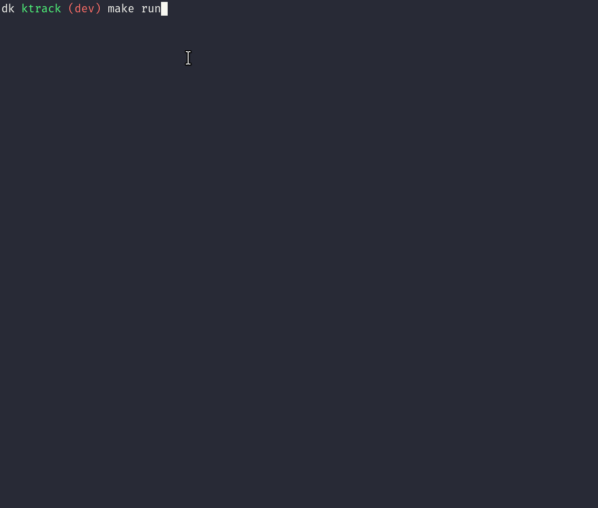

# ktrack

Mouse tracking using Kalman filter demo.



## Dependencies

- `cmake` and `make` for building
- [SDL2 library with TTF support](https://www.libsdl.org/) for GUI
- [GSL library](https://www.gnu.org/software/gsl/) for linear algebra
- [Doxygen](https://www.doxygen.nl/) if you want to build documentation

## Bulding

Tested only on GNU/Linux.

Release build:
```console
make
```
Debug build:
```console
make debug=y
```

Documentation:
```console
make docs
```

## Running

```console
make run
```

## Configuration

Application is mostly configured by constants in `app/src/config.h`. You can
change some stuff there and recompile the program to see results.

## References
Here's a [great article](https://www.bzarg.com/p/how-a-kalman-filter-works-in-pictures/) about Kalman filter.
